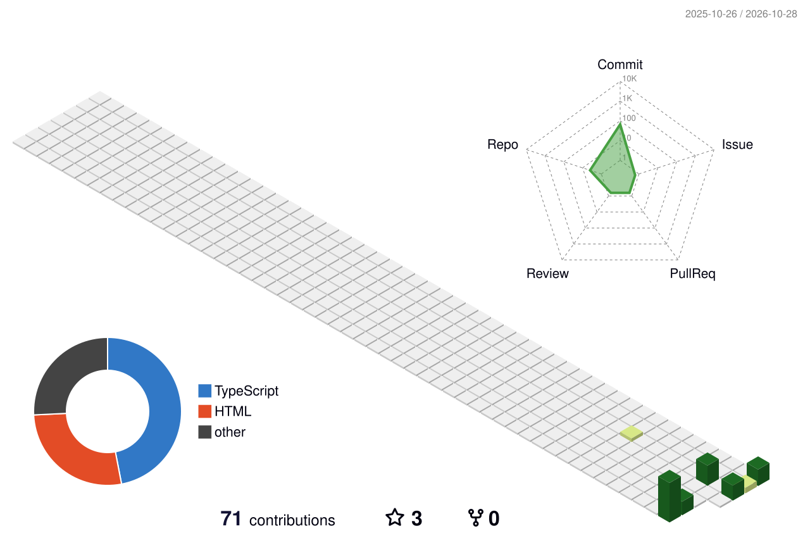

#  🙋 Hello

### 🤺 About Me

&emsp;&emsp;嗨，你好，我是小熊同学。热爱编程、摄影、读书、旅行。

&emsp;&emsp;热爱计算机科学和 IT 互联网事业，专注 **Java 后端开发**，技术栈以 **Spring Boot · Redis · MySQL** 为核心。

&emsp;&emsp;我们正在让这个世界变得更加美好，通过代码的重复使用和延展构建完美体系。

&emsp;&emsp;**We're making the world a better place. Through constructing elegant hierarchies for maximum code reuse and extensibility.**

<picture>
  <source media="(prefers-color-scheme: dark)" srcset="https://xxh11432.github.io/assets/images/coding.gif" />
  <source media="(prefers-color-scheme: light)" srcset="https://xxh11432.github.io/assets/images/developer.svg" height="225px" />
  
</picture>

&nbsp;

<!-- 数据统计 -->

### 🚀 开源项目

<!-- 开源项目卡片 -->

### 🛠️ 技术栈

<!-- 后端技术徽章 -->

<!-- skillicons 后端图标 -->

<!-- techstack-generator 动态图标 -->

### 📊 GitHub 统计

<!-- 统计卡片（实时数据） -->

<!-- 3D 贡献图 -->

<!-- 贪吃蛇贡献图 -->
<picture>
  <source media="(prefers-color-scheme: dark)" srcset="./profile-snake-contrib/github-contribution-grid-snake-dark.svg" />
  <source media="(prefers-color-scheme: light)" srcset="./profile-snake-contrib/github-contribution-grid-snake.svg" />
  
</picture>

